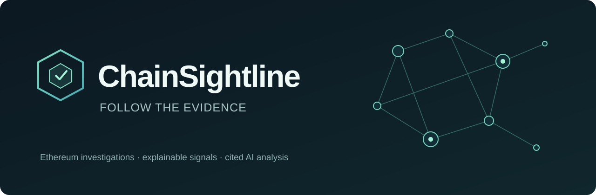
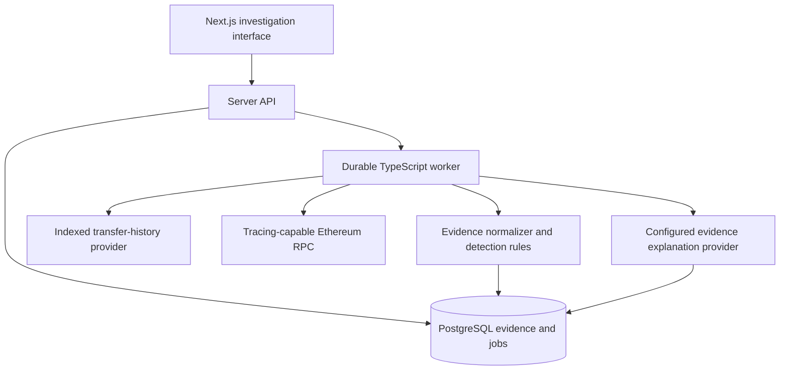

  

# ChainSightline

**Evidence-first Ethereum investigations, explained clearly.**

A read-only workspace being built for examining transactions, understanding risk signals and tracing observed asset movements. Deterministic analysis comes first; an explicitly configured AI model explains the evidence with citations.

> [!IMPORTANT]
> **Early development.** A polished local browser workspace with synthetic evidence and a tested model-provider adapter exists. Live blockchain integration, durable investigations and real detection are not connected. Diagrams describe the planned product.

## Why ChainSightline?

Blockchain data is public, but interpreting it is difficult. A transaction hash alone does not explain contract calls, token approvals or the context behind a transfer.

ChainSightline is designed to make investigations understandable without hiding uncertainty:

- **Inspect** an Ethereum address or transaction.
- **Trace** observed native ETH, token movements and contract calls.
- **Understand** explainable signals with supporting transactions.
- **Check** AI explanations against their cited evidence.

It will not label an address criminal, infer wallet ownership from a graph connection or call incomplete evidence safe.

## Planned workflow

```mermaid
flowchart LR
    A["Address or transaction"] --> B["Bounded evidence collection"]
    B --> C["Receipts, logs and call traces"]
    C --> D["Versioned rules and sourced labels"]
    D --> E["Evidence and movement graph"]
    E --> F["Optional cited AI explanation"]

    style A fill:#dcefeb,stroke:#3c8d94,color:#10272d
    style B fill:#dcefeb,stroke:#3c8d94,color:#10272d
    style C fill:#dcefeb,stroke:#3c8d94,color:#10272d
    style D fill:#dcefeb,stroke:#3c8d94,color:#10272d
    style E fill:#dcefeb,stroke:#3c8d94,color:#10272d
    style F fill:#d9f3e5,stroke:#41a98f,color:#10272d
```

## Product principles

| Principle | What it means |
| --- | --- |
| Evidence before conclusions | Every signal links to source observations and coverage. |
| Honest uncertainty | Missing traces, unsupported activity and partial history stay visible. |
| AI with boundaries | A configured compatible model summarizes a frozen evidence bundle; validation rejects invented citations. |
| Small, measurable scope | Ethereum first. No full-chain indexing or cross-chain claims in the MVP. |
| Read-only by design | No wallet signing, transaction submission or automated fund blocking. |

## Planned architecture

**Planned architecture; no deployed infrastructure yet.**

**TypeScript throughout:** Next.js, React, viem, PostgreSQL, Drizzle, pg-boss, Zod and Cytoscape.js. One web application and one worker; no premature microservices.

See the [full architecture](docs/plans/2026-11-02-blockchain-investigation-tool-design.md) for provider coverage, canonical evidence, transfer semantics, recovery and security contracts.

## Roadmap

| Milestone | Scope | Status |
| --- | --- | --- |
| Architecture and repository | Reviewed design, private repository and project guidance | Complete |
| AI provider contract | Model-neutral evidence schema, OpenRouter adapter and offline tests | Initial slice complete |
| Local browser workspace | Responsive investigation UI, synthetic evidence and health endpoint | Initial preview working |
| TypeScript foundation | Workspace, database, authentication, jobs and CI | UI started; infrastructure pending |
| Offline transaction evidence | Synthetic fixtures, normalization and evidence interface | UI fixture only |
| Live Ethereum investigation | Provider-backed transaction and bounded address history | Not started |
| Signals and graph | Explainable rules and single-transaction movement graph | Not started |
| Cited AI analysis | Configurable model summaries over frozen evidence | Adapter smoke tested |
| Private preview | Security, recovery, evaluation and cost verification | Not started |

The detailed [delivery roadmap](docs/plans/2026-11-02-github-roadmap.md) tracks GitHub setup and release gates. The [concept review](docs/reviews/2026-11-02-concept-review.md) records strengths, weaknesses and improvement priorities.

## Development and model access

Run `npm ci`, then `npm run dev` and open `http://localhost:3000`. For the Docker launcher, run `npm start`; it builds the app, waits for health and opens your default browser. `npm stop` stops services without deleting data. The current preview uses synthetic evidence; no chain provider is required. Verify with `npm test`, `npm run typecheck`, `npm run build` and, while the app is running, `npm run test:browser`. Real environment files are ignored by Git.

Kimi K3.1 Pro remains the primary development model and default product-analysis model. OpenRouter provides the initial provider-neutral transport; Kimi, OpenAI and Google models passed a small synthetic structured-output compatibility test. Compatible models are supported, not every possible model. No silent fallback or automatic weakening of privacy settings. See [AI provider configuration](docs/ai-providers.md) and the [measured smoke report](docs/reviews/2026-11-02-ai-provider-smoke.md).

## Security and release

Not yet publicly released. Licensing, contribution policy, security reporting and tested setup instructions remain release prerequisites. See [security and data-handling notes](SECURITY.md) for design boundaries and reporting guidance.

No license has been selected. Reuse and redistribution are not currently granted.

---

*ChainSightline is the selected working identity following preliminary name-conflict checks. Trademark clearance remains a separate public-release step.*
