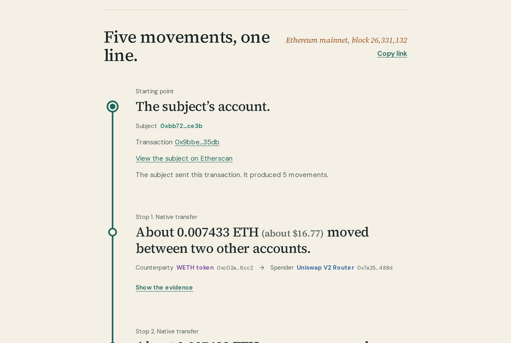
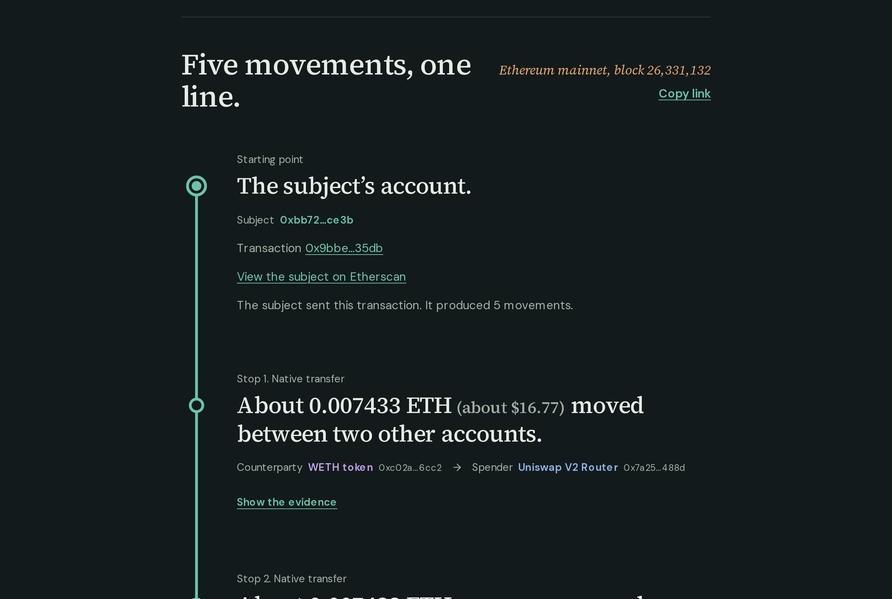
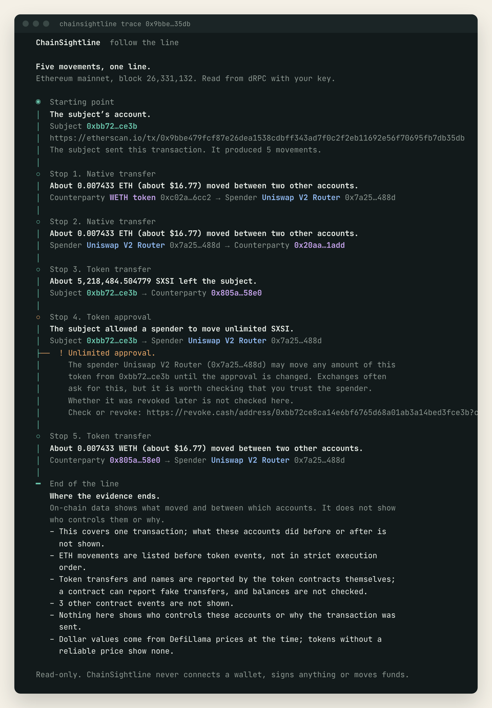
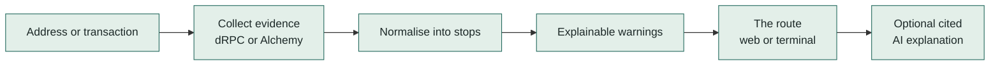
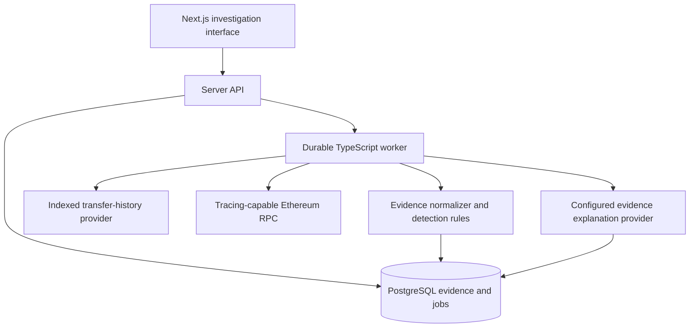

<p align="center">
  
</p>

# ChainSightline

**Follow the line.** ChainSightline turns blockchain activity into one route you read from top to bottom: what moved, between whom, which warnings deserve a look, and exactly where the evidence ends.

> [!IMPORTANT]
> **Early preview.** ChainSightline reads real Ethereum mainnet transactions with no setup and no keys. Address history needs a free Alchemy key. Detection rules are basic so far: a warning is a reason to look closer, never a verdict.

<p align="center">
  
  
</p>

## Try it

You need [Node.js](https://nodejs.org) 22.12 or newer. Docker is optional.

```sh
git clone https://github.com/sjdsjadjajdjsa/chainsightline.git
cd chainsightline
npm install
```

### In your terminal

```sh
npm run cli -- trace 0xTransactionHash   # follow a real transaction, no key needed
npm run cli -- trace 0xAddress           # recent transfers in and out (needs an Alchemy key)
npm run cli -- trace 0x… --evidence      # add full addresses and exact amounts
npm run cli -- trace 0x… --json          # machine-readable output
npm run cli -- sample                    # the invented example route
```

Run `npm link` once to use it as `chainsightline` from anywhere, for example `chainsightline trace 0x…`.

<p align="center">
  
</p>

### In your browser, no Docker

```sh
npm run web          # or: chainsightline web
```

The first run builds the site, then it opens at `http://127.0.0.1:3000` in your default browser. Press Ctrl+C to stop it. Use `--port 3001` if 3000 is busy and `--no-open` to skip the browser.

### In Docker

```sh
npm start            # build, wait until healthy, open the browser
npm stop             # stop without deleting data
```

The container is read-only, runs as a non-root user and is reachable only from your own computer.

## Your own keys (optional)

ChainSightline works out of the box using dRPC's free public access. Free keys of your own make it faster and unlock more:

| Key | What it adds | Get one |
| --- | --- | --- |
| dRPC | Faster, more reliable transaction lookups | [drpc.org](https://drpc.org/login): create a key, open its Settings tab, copy the key |
| Alchemy | Address history: recent transfers in and out of any address | [alchemy.com](https://www.alchemy.com): create an app for Ethereum, copy its API key |

Add them whichever way is easiest:

- **In the website:** click **Your keys** under the search box and paste. Each key is checked before it is saved.
- **In the terminal:** run `chainsightline setup` (or `npm run cli -- setup`). `chainsightline keys` shows what is set.
- **In a file:** put `DRPC_KEY=…` and `ALCHEMY_API_KEY=…` in a `.env` file in the project folder. Docker picks these up too.

You can paste either the key itself or the whole link the provider shows you. Keys stay on your computer (`~/.config/chainsightline/keys.json`, readable only by you), are only ever sent to the provider they belong to, and never appear in output or error messages.

## How it works



1. You paste an address or transaction hash. It is checked before anything else happens.
2. ChainSightline asks a data provider for the transaction, its receipt, its block and its call trace. Your own key is used first; if it fails, dRPC's free public access takes over. For an address, Alchemy returns its 20 most recent transfers.
3. Each movement becomes a stop with a plain sentence such as "0.42 ETH left the subject", plus the two addresses colour-coded and labelled by role. ETH sent with the transaction, ETH moved between contracts inside it, token and NFT transfers, and approvals are all included. Token names are read from the token contracts. Addresses show their ENS name or a known label (exchanges, routers, major tokens) next to the hash, and amounts show their dollar value from DefiLlama.
4. Rules attach warnings to the stop they concern: unlimited and collection-wide approvals (with a link to revoke them), lookalike addresses and address poisoning, zero-value transfers planted in someone else's history, fake copies of USDT, USDC, DAI, WETH, WBTC, stETH and ETH, tokens whose names advertise websites, and transfers out of a wallet that the wallet never sent. A warning is a reason to look closer, never a verdict.
5. The route ends with what is still unknown, such as a missing call trace, hidden events, or movements beyond the first 40, so missing data never reads as safety.
6. Planned: an AI model (Kimi by default, or any compatible OpenRouter model) explains the route. Its answer must cite the evidence or it is rejected. The adapter is built and tested but not yet wired into the app.

Every stop links to Etherscan so you can check it yourself, and the address bar updates (for example `?tx=0x…`) so you can copy a link that reopens the same investigation in any ChainSightline.

The website and the terminal share the same evidence format and wording, so both always tell the same story.

**What leaves your computer:** the transactions and addresses you look up go to your chain provider (dRPC or Alchemy), and token contract addresses with the block time go to [DefiLlama](https://defillama.com) for prices. Set `CHAINSIGHTLINE_PRICES=off` to turn prices off.

## Product principles

| Principle | What it means |
| --- | --- |
| Evidence before conclusions | Every signal links to source observations and coverage. |
| Honest uncertainty | Missing traces, unsupported activity and partial history stay visible. |
| AI with boundaries | A configured compatible model summarizes a frozen evidence bundle; validation rejects invented citations. |
| Small, measurable scope | Ethereum first. No full-chain indexing or cross-chain claims in the MVP. |
| Read-only by design | No wallet signing, transaction submission or automated fund blocking. |

## Planned architecture



**Planned architecture; no deployed infrastructure yet.**

**TypeScript throughout:** Next.js, React, viem, PostgreSQL, Drizzle, pg-boss, Zod and Cytoscape.js. One web application and one worker; no premature microservices.

See the [full architecture](docs/plans/2026-11-02-blockchain-investigation-tool-design.md) for provider coverage, canonical evidence, transfer semantics, recovery and security contracts.

## Roadmap

| Milestone | Scope | Status |
| --- | --- | --- |
| Architecture and repository | Reviewed design, private repository and project guidance | Complete |
| AI provider contract | Model-neutral evidence schema, OpenRouter adapter and offline tests | Complete for the preview |
| Sightline website | One-line route design, intro, light and dark themes, mobile layout | Preview working |
| Terminal command | `chainsightline trace`, `sample`, `web`, `setup` and `keys` without Docker | Preview working |
| Live Ethereum investigation | Real transactions without keys; recent address history with Alchemy | Preview working |
| Easy keys | Paste keys in the website or terminal, checked before saving | Preview working |
| Branching routes | One address sending to several, shown on the line | Design needed |
| Readable routes | ENS names, known labels, dollar values, Etherscan and revoke.cash links, shareable links | Preview working |
| Signals | Approvals, address poisoning, fake and spam tokens, unsent transfers | First rules working |
| Cited AI analysis in the app | Configurable model explanations over frozen evidence | Adapter tested |
| Private preview | Database, jobs, security, recovery and cost checks | Not started |

The detailed [delivery roadmap](docs/plans/2026-11-02-github-roadmap.md) tracks release gates. The [concept review](docs/reviews/2026-11-02-concept-review.md) records strengths, weaknesses and priorities. The [design system](design_system/README.md) explains the visual rules.

## Development

```sh
npm run dev            # live-reloading website
npm test               # unit tests for the evidence format, route wording, CLI and AI adapter
npm run typecheck
npm run test:browser   # with the site running: phone, laptop and ultrawide checks in both themes
npm run test:chain:live  # with DRPC_KEY in a local .env file: one real receipt and trace from Ethereum
CHAINSIGHTLINE_LIVE_TX=0x… npm run test:browser   # also render a real transaction in the browser
```

Kimi K3.1 Pro is the primary development model and the default product model. OpenRouter provides the provider-neutral transport; Kimi, OpenAI and Google models passed a small structured-output compatibility test. There is no silent fallback and privacy settings are never weakened automatically. See [AI provider configuration](docs/ai-providers.md) and the [smoke report](docs/reviews/2026-11-02-ai-provider-smoke.md). Real environment files are ignored by Git.

## Security and release

Not yet publicly released. A license, contribution policy and private security contact are still needed before the repository goes public. See [security and data-handling notes](SECURITY.md).

No license has been selected. Reuse and redistribution are not currently granted.

---

*ChainSightline is the selected working name following preliminary name-conflict checks. Trademark clearance remains a separate public-release step.*
