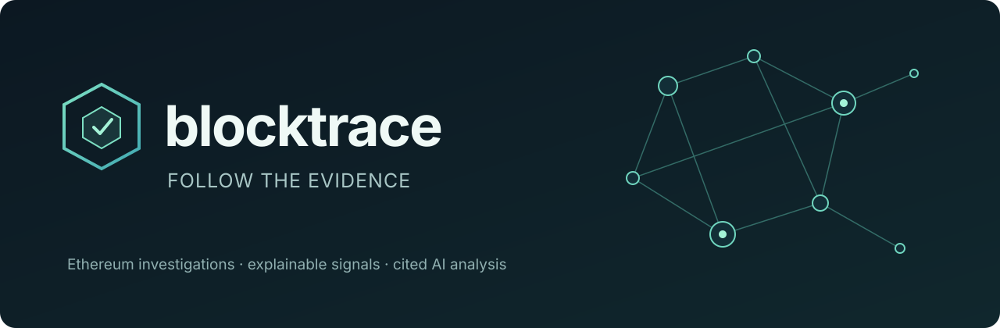
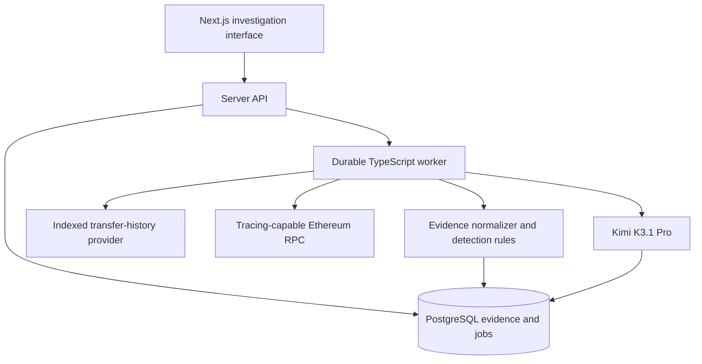

  

# Blocktrace

**Evidence-first Ethereum investigations, explained clearly.**

A planned read-only workspace for examining transactions, understanding risk signals and tracing observed asset movements. Deterministic analysis comes first; Kimi K3.1 Pro explains the evidence with citations.

> [!IMPORTANT]
> **Design stage.** No runnable application or live blockchain integration exists yet. The diagrams below describe the planned product, not implemented or benchmarked capabilities.

## Why Blocktrace?

Blockchain data is public, but interpreting it is difficult. A transaction hash alone does not explain contract calls, token approvals or the context behind a transfer.

Blocktrace is designed to make investigations understandable without hiding uncertainty:

- **Inspect** an Ethereum address or transaction.
- **Trace** observed native ETH, token movements and contract calls.
- **Understand** explainable signals with supporting transactions.
- **Check** AI explanations against their cited evidence.

It will not label an address criminal, infer wallet ownership from a graph connection or call incomplete evidence safe.

## Planned workflow

## Product principles

| Principle | What it means |
| --- | --- |
| Evidence before conclusions | Every signal links to source observations and coverage. |
| Honest uncertainty | Missing traces, unsupported activity and partial history stay visible. |
| AI with boundaries | Kimi summarizes a frozen evidence bundle; it cannot invent transactions or verdicts. |
| Small, measurable scope | Ethereum first. No full-chain indexing or cross-chain claims in the MVP. |
| Read-only by design | No wallet signing, transaction submission or automated fund blocking. |

## Planned architecture

**Planned architecture; no deployed infrastructure yet.**

**TypeScript throughout:** Next.js, React, viem, PostgreSQL, Drizzle, pg-boss, Zod and Cytoscape.js. One web application and one worker; no premature microservices.

See the [full architecture](docs/plans/2026-11-02-blockchain-investigation-tool-design.md) for provider coverage, canonical evidence, transfer semantics, recovery and security contracts.

## Roadmap

| Milestone | Scope | Status |
| --- | --- | --- |
| Architecture and repository | Reviewed design, private repository and project guidance | Complete |
| TypeScript foundation | Workspace, database, authentication, jobs and CI | Not started |
| Offline transaction evidence | Synthetic fixtures, normalization and evidence interface | Not started |
| Live Ethereum investigation | Provider-backed transaction and bounded address history | Not started |
| Signals and graph | Explainable rules and single-transaction movement graph | Not started |
| Cited AI analysis | Kimi summaries over frozen evidence | Not started |
| Private preview | Security, recovery, evaluation and cost verification | Not started |

The detailed [delivery roadmap](docs/plans/2026-11-02-github-roadmap.md) tracks GitHub setup and release gates. The [concept review](docs/reviews/2026-11-02-concept-review.md) records strengths, weaknesses and improvement priorities.

## Development and model access

Application setup and verification commands will arrive with the TypeScript foundation. `.env.example` contains placeholders only; real environment files are ignored by Git.

Kimi K3.1 Pro is the primary development model and intended product-analysis model. Application inference needs separate authorized **Kimi Platform API** access; a Kimi Code subscription is not assumed to provide it.

## Security and release

Not yet publicly released. Licensing, contribution policy, security reporting and tested setup instructions remain release prerequisites. See [security and data-handling notes](SECURITY.md) for design boundaries and reporting guidance.

No license has been selected. Reuse and redistribution are not currently granted.

---

*Blocktrace is a working project name. The repository is named `blockchain` during early development.*
