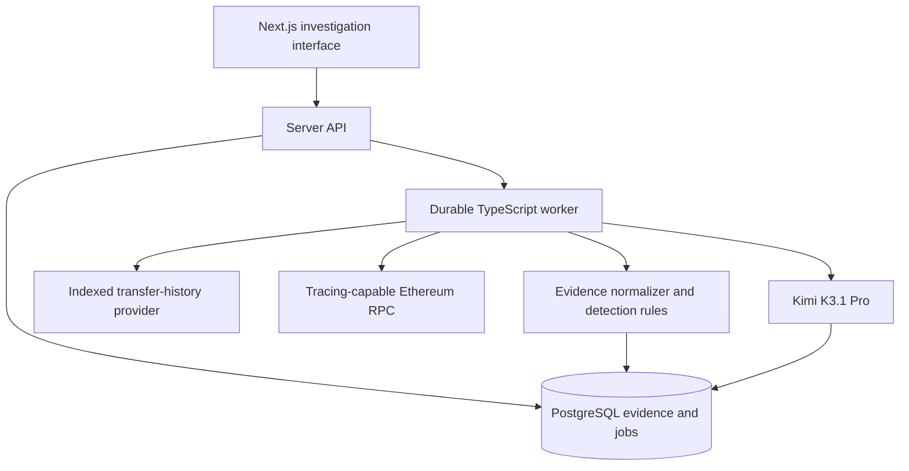

# Blockchain investigation tool design

Status: reviewed and documented, 2026-11-02; application implementation approval pending

## 1. Purpose and scope

Build a read-only Ethereum investigation tool. A person pastes an address or transaction hash, receives a clear evidence-backed risk summary, and can inspect the activity and a bounded transaction graph. Start with one authenticated owner for local and acceptance testing; advanced views serve investigators without overwhelming casual users. Anonymous public access is a later, explicitly rate-limited deployment decision.

Kimi K3.1 Pro is the primary development model and the only model used for product AI analysis. Other models may review the implementation.

The first release is limited to Ethereum mainnet, recent-bounded investigations, explainable heuristic signals and explicitly sourced address labels. It does not claim to find all crime, prove wallet ownership, recover funds, block transfers, provide legal conclusions or track people off-chain. Missing data produces an unknown or partial result, never a clean bill of health.

### Non-goals for the first release

- Full-chain indexing or a self-hosted archive node
- Cross-chain tracing or non-EVM chains
- Mixer or exchange wallet attribution beyond sourced public labels
- Automatic taint propagation that treats every connected address as guilty
- Unsupervised anomaly scoring presented as reliable fraud detection
- Private watchlists, notifications, collaboration and automated case reports
- Wallet signing, transaction submission or interaction with suspected malicious contracts

## 2. Primary workflow

1. A visitor submits a validated Ethereum address or transaction hash.
2. The authorized server creates or reuses an investigation pinned to the finalized Ethereum block number and hash, atomically queues collection, and immediately opens a progress page.
3. A worker collects one bounded page of indexed transfer history for an address or receipt, logs and an available call tree for a transaction.
4. Normalized evidence is stored with block identity, source and coverage. Versioned rules and sourced labels produce visible signals.
5. The page shows a plain-language summary, signal severity and reason, source transactions, coverage, and an optional graph. It offers a cited Kimi explanation as a separate, on-demand action.
6. A visitor can inspect an evidence item, request another history page or open a selected transaction. The first graph is one transaction's observed native/ERC-20 movements, capped at 50 nodes and 200 edges with visible truncation. Recursive cross-transaction graph expansion is deferred.

The browser never receives provider or model credentials. No off-chain identity is required to inspect an address. Public identifiers can become personal data when linked to someone, and investigation history can be sensitive. Retention, deletion, cache isolation and log redaction apply from the first owner deployment; users must be told what is sent to providers and Kimi.

## 3. Architecture

Zod and shared domain types cross every API, worker, provider and model boundary. Drizzle manages PostgreSQL schema and reviewed migrations.

Use `apps/web` for Next.js UI and route handlers, `apps/worker` for collection and analysis, `packages/core` for Zod contracts and evidence rules, `packages/providers` for adapters, and `packages/db` for migrations, repositories and queue integration. Run PostgreSQL, web and worker with Docker Compose locally. Deploy web and worker separately using one database and the same released application version.

All provider collection and Kimi requests are jobs. Use four bounded types initially: `address-history-page`, `transaction-evidence`, `analyze-evidence` and `summarize-evidence`. pg-boss supplies PostgreSQL-backed retries, expiration, heartbeats, concurrency and transactional job submission. Commit investigation creation and job submission atomically. Keep durable investigation state separate from queue state; terminal states are `complete`, `partial` or `failed`. Receipt/log results survive trace failure.

Use unique observation and derived-output keys, bounded backoff and provider-wide concurrency budgets. Keep external calls outside database transactions, persist successful stages before retrying failed stages, and use attempt identity to prevent expired work from overwriting newer results. Key derivations by evidence-set and analyzer version. Poll persisted status; no WebSocket service is needed.

### Locked technology

| Concern | Choice | Purpose |
| --- | --- | --- |
| Runtime and language | TypeScript on the current active Node.js LTS | Shared server, worker and domain code |
| Web | Next.js 16.4 and React 19.3 | UI and server route handlers |
| Chain reads | viem plus provider-specific adapters | Typed standard RPC; isolate nonstandard history and traces |
| Database | PostgreSQL 18, Drizzle ORM, generated SQL migrations | Exact values, evidence provenance, relational queries and durable work |
| Jobs | pg-boss | PostgreSQL-backed retries, heartbeats and restart-safe work |
| Validation | Zod | Parse provider, API, persisted and model data |
| Graph | Cytoscape.js | Interactive bounded transaction graph |
| AI | Kimi K3.1 Pro through an isolated server-side client | Evidence-cited explanation, no fallback model |
| Local runtime | Docker Compose | Reproducible web, worker and database |

Pin exact package versions during implementation after checking current releases. Do not select client component libraries before the design-system work.

## 4. Provider boundary and coverage

Select an initial provider with both indexed history and historical execution tracing for Ethereum mainnet. Alchemy is the leading candidate: `alchemy_getAssetTransfers` supplies paginated address history and `debug_traceTransaction` supports call tracing. This is a candidate, not an authenticated selection: development must first verify the chosen account's plan, completeness, historical limits, retention, quotas, commercial terms and actual output against known fixtures.

Define separate capability-based `HistoryProvider` and `ChainProvider` interfaces; do not imply that a transfer index provides all transactions:

- `HistoryProvider.capabilities(chain)`: indexed categories, direction, block bounds, page limits and cursor expiry.
- `HistoryProvider.history(address, direction, cursor, budget)`: typed transfers, next cursor, requested/covered ranges, index watermark or unknown watermark, and completeness within the declared scope.
- `ChainProvider.capabilities(chain)`: historical range, trace method/format and relevant limits.
- `ChainProvider.finalizedHead()` and `block(identifier)`: canonical anchor and block identity.
- `ChainProvider.transaction(hash)`: typed transaction, receipt, logs and canonical block metadata.
- `ChainProvider.trace(hash)`: provider-native call tree, never synthesized from top-level transactions or opcode-level tracing.
- `entityMetadata(address)`: attributed labels with source and retrieval time, or explicitly unsupported.

The initial provider can implement this interface directly. Standard reads use viem; nonstandard calls remain in the adapter. Store immutable raw provider responses or a stable retrievable reference, normalized observations, pagination cursors and errors separately. Provider data is untrusted until schema-validated.

Ordinary `eth_getLogs` and standard transaction RPC methods do not provide complete arbitrary-address history. Alchemy's transfer documentation excludes zero-value internal transfers, `delegatecall` entries and miner rewards from its internal-transfer category. Its page keys expire after ten minutes. Therefore the UI says **indexed transfer history**, not “all activity.” Distinguish no results, unsupported coverage, incomplete indexing and provider failure. Check receipt, trace and history block identities before combining them; lag or mismatch makes evidence incomplete. A fallback must preserve its actual coverage and provenance.

## 5. Evidence and data model

All integer amounts use decimal strings in JSON, big integers in TypeScript and `NUMERIC` in PostgreSQL. Addresses and hashes are normalized after full validation. Chain ID is part of every entity identity. Public addresses and hashes remain plain values; private case annotations, if added later, receive separate authorization and encryption treatment.

Core tables:

- `sources`: provider/source, retrieval time, source version and attribution metadata.
- `entities`: `(chain_id, address)`, public label references and metadata freshness.
- `observations`: immutable, typed records tied to `(chain_id, block_hash, transaction_hash)` and source. Categories distinguish native ETH, fungible tokens, NFTs, successful internal calls, approvals, failed top-level transactions and unsupported activity. Preserve native event index, call path, raw amount, decimals, token contract and direction.
- `investigations`: owner, subject, requested scope, status, finalized anchor number/hash, created time, progress and cancellation.
- `collection_runs`: cursor, window, provider capabilities, attempted/completed ranges, error details and coverage result.
- `signals`: rule ID/version, severity, evidence IDs, human-readable reason, thresholds and benign alternatives. A signal is not a verdict.
- `investigation_views`: frozen evidence-set reference, rule set, source snapshot and assembled coverage used by the UI and AI.
- `ai_analyses`: requested model, exact evidence-set hash, prompt/schema versions, bounded input, structured output, validation outcome and token/cost metadata.
- `label_assertions`: claim, category, source URL/document, publisher, retrieval time and confidence in the label's provenance. No invented entity names or severity.

Use `(chain_id, block_hash, native observation identity)` for idempotency, not only transaction hash. Record provider, retrieval time, request scope and normalization version on evidence. Transactions newer than the finalized anchor are `awaiting_finalization`, not silently included. Derived findings and summaries reference a frozen evidence-set version. Preserve reverted top-level status separately from call status. Where trace success cannot be established, coverage says so.

## 6. Execution and fund-flow tracing

Execution tracing answers what happened inside a transaction. Decode the provider-normalized call tree, raw logs, limited ERC-20 events, approvals and internal ETH movements where supported; preserve call depth, call path and failure status. Exclude descendants of reverted calls, do not count the root call's native value twice, and never interpret `delegatecall` value as a separate transfer. Token logs are observed contract-emitted events, not proof of token authenticity, economic value or exact balance changes. Preserve token contract, raw integer amounts and unknown decimals. Public metadata is supplemental and cannot override execution.

The first graph is the selected transaction's observed native and ERC-20 movements. Nodes are public addresses; edges contain asset, raw amount, transaction and evidence references. Display no more than 50 nodes and 200 edges and visibly mark truncation. Raw NFT logs remain visible as evidence but are not decoded into the first graph.

Later multi-transaction fund-flow views use a documented time window, hop count and hard edge, request and latency budgets. Each expansion is a new job with a cursor and explicit coverage. Exchanges, bridges and other high-degree entities are labeled only when sourced and are not recursively expanded by default.

A path is evidence of observed blockchain exposure, not proof of common ownership, intent or culpability. No heuristic taint score is inherited across a path in the first release.

## 7. Detection and explanation

### Deterministic detection

1. **Sourced known-entity match:** an exact subject or observed counterparty matches a published label with attribution. State who published the label and when it was retrieved.
2. **Possible address poisoning:** a small unsolicited inbound transfer is followed within a documented time window by an outbound transfer to a different, visually similar address. Define the legitimate comparison address, supported transfer types, prefix/suffix similarity, amount and time thresholds in versioned rules. Display both directions and benign alternatives. Abstain when required comparison history is absent. Incoming dust alone is never evidence against its recipient.
3. **Historical approval observed:** identify unlimited or unusually broad approvals from decoded observed events. State token, spender, scope and time; do not call the spender malicious without evidence. A transfer index is not an approval index, and a historical event does not establish current allowance. Any separate **current allowance verified** result must use a block-pinned read for a known owner/spender pair. Discovering every spender or supporting permit mechanisms requires additional coverage and is outside the first slice.
4. **Activity pattern context:** rapid fan-out, peel-chain-like sequences and fresh-address bursts may be investigated later after fixtures and false-positive testing. They are not first-slice accusations and have no automatic severity based only on graph shape.

Rules return structured reasons, evidence references, relevant thresholds and possible benign explanations. No opaque universal risk score is needed for the MVP. Severity indicates why review is warranted, not guilt.

### Kimi analysis

Use the Kimi Platform OpenAI-compatible API for product integration, with server-held credentials, a configurable model identifier and `kimi-k3.1-pro` as the intended official API model. The Kimi Code subscription is used for development through the coding integration. Current official documentation distinguishes that subscription from product API usage, so implementation must verify the product credential, model access, quota, retention and commercial terms before enabling application analysis. No browser credential, alternative model or silent fallback.

The model receives only a versioned, bounded investigation package: coverage, supported signals, normalized evidence excerpts, provenance and requested output schema. Raw trace dumps are not sent wholesale. Evidence IDs are opaque server-generated references; every returned citation must resolve to an included item.

Use strict JSON schema output. Validate the response and reject unsupported evidence IDs. Store the evidence-set hash with the analysis. Constrain factual AI output to typed claims grounded in supplied fields; render critical findings from deterministic templates and keep free-form explanation separate. Test amount, direction, identity, causation and certainty errors. A valid citation is not proof of claim support. Display deterministic evidence first and label generated text as AI analysis. The UI works when the model is disabled, rate-limited or wrong.

All on-chain text, token metadata, labels and fetched content are untrusted data, not instructions. Delimit them in the prompt and never allow them to change tools, credentials or system instructions. Kimi receives no provider keys, session secrets, user credentials or unrelated investigations. Add explicit request budgets and server-side cost controls.

## 8. API and interface

Initial endpoints:

- `POST /api/investigations`: validate subject and scope; create or reuse pinned work.
- `GET /api/investigations/:id`: owner-authorized investigation status and bounded results.
- `GET /api/investigations/:id/evidence?cursor=...`: typed, paginated evidence and signals.
- `POST /api/investigations/:id/history-pages`: explicit continuation of indexed transfer history.
- `POST /api/investigations/:id/analysis`: on-demand Kimi analysis for the frozen evidence set.
- `GET /api/investigations/:id/analysis`: validated stored explanation or explicit unavailable status.

Authenticate the initial owner and authorize every investigation, job and result access. Use unguessable investigation IDs, a server-only data access layer and minimal DTOs; never expose raw database records or credentials. Apply request size limits, owner and subject rate limits, global/provider concurrency limits, output escaping and conventional security headers. Do not automatically fetch arbitrary on-chain URLs. Define retention, deletion and log redaction, disable shared caching of private metadata and add backups with tested restores before any hosted pilot. Anonymous access requires separate abuse controls and deployment approval.

### Screen hierarchy

1. Address or transaction search with examples and supported-chain statement.
2. Summary: observed activity, risk signals, coverage and timestamp.
3. Signal cards with plain-language reasons and inspectable transaction evidence.
4. Single-transaction movement graph with explicit limits and legend.
5. Optional AI explanation with citations, unknowns and coverage warning.

The interface must never show a green “safe” state based on no matches. Use “no supported signals observed in the inspected activity” with coverage. Accessibility, responsive graph alternatives and a tabular evidence view are required.

## 9. Verification and delivery

### Stage 0: contracts and fixtures

Confirm provider capabilities and Kimi Platform product access. Capture sanitized real provider responses for known cases. Build a versioned evaluation set with benign regular activity, dust recipients, approvals, known flagged entities, failed transactions, internal calls and provider-pagination boundaries. Write acceptance criteria and coverage assertions before coding.

### Stage 1: transaction evidence

Implement validation, one transaction lookup, receipt/log/trace normalization, persistence, coverage and an evidence page. Prove correct handling of reverted transactions, token amounts, absent traces and provider failures.

### Stage 2: address investigation

Add one page of indexed transfer history, investigation jobs, cancellation, progress, the single-transaction graph and explicit coverage. Selecting a transaction opens its evidence view. Test repeated submissions, worker crashes, cursor expiry, index lag, block mismatch and idempotency against real provider fixtures.

### Stage 3: explainable signals and Kimi

Implement sourced labels, address-poisoning and approval rules, their evidence UI, then the frozen evidence package and cited Kimi output. Measure rule precision/recall on the curated labeled set and report false positives separately from cases the provider cannot observe. Test fabricated citations, missing evidence, on-chain prompt injection, timeout, quota exhaustion and schema rejection.

### Post-MVP: private watchlists

Only after authorization is designed, add owner-scoped watchlists, block-hash-aware checkpoints, atomic observed-state transitions, confirmation policy and reorg reconciliation. An observation keyed by transaction hash alone is insufficient; reorg handling must use block identity. Notifications remain out of scope until the scanning and recovery behavior is verified.

### Required end-to-end checks

- Real provider transaction and address investigations with visible coverage and source attribution.
- Restart during pagination without duplicate or lost stored observations.
- Reverted top-level transactions and failed subcalls never become successful flows.
- Benign dust recipient and ordinary approval fixtures do not receive unsupported accusations.
- Graph budget enforcement and clear truncation under a high-degree counterparty.
- AI cannot cite absent evidence or alter the deterministic signal set. Valid references alone are not proof that a generated claim is supported; unsupported claims are rejected rather than shown as established findings.
- Unauthorized credentials cannot reach the browser or arbitrary model/provider requests.
- Measured provider usage, latency and model costs inform the final public rate limits.

## 10. Alternatives and future evolution

Rust with Alloy remains a candidate for a measured high-volume ingestion bottleneck, not the initial application. Python with FastAPI is useful for research and ML pipelines, but adds a second backend without a current requirement. Either would preserve the evidence contracts and provider boundary rather than require rewriting the UI.

Move to an independent indexer only when provider cost, coverage or control is demonstrably inadequate. Introduce a dedicated graph store or ML model only after an evaluation set proves the PostgreSQL graph queries and deterministic signals insufficient.

## 11. Current official references

Checked 2026-11-02:

- [Kimi model list](https://platform.kimi.ai/docs/models)
- [Kimi K3.1 Pro quickstart](https://platform.kimi.ai/docs/guide/kimi-k3-1-pro-quickstart)
- [Kimi structured output](https://platform.kimi.ai/docs/guide/response_format)
- [Kimi Code versus Kimi Platform](https://www.kimi.com/code/docs/en/)
- [Alchemy indexed address transfers](https://www.alchemy.com/docs/data/transfers-api/transfers-endpoints/alchemy-get-asset-transfers)
- [Alchemy transaction tracing](https://www.alchemy.com/docs/chains/debug-api/debug-api-endpoints/debug-trace-transaction)
- [Ethereum JSON-RPC API](https://ethereum.org/en/developers/docs/apis/json-rpc/)
- [Reth trace namespace](https://reth.rs/jsonrpc/trace)
- [viem custom client](https://viem.sh/docs/clients/custom)
- [Next.js 16.4](https://nextjs.org/blog/next-16-4)
- [PostgreSQL 18 documentation](https://www.postgresql.org/docs/current/)
- [Drizzle migrations](https://orm.drizzle.team/docs/migrations)
- [pg-boss jobs](https://pgboss.io/api/jobs)
- [Next.js data security](https://nextjs.org/docs/app/guides/data-security)
- [Alchemy transfer coverage and pagination](https://www.alchemy.com/docs/reference/transfers-api-quickstart)
- [Cytoscape.js](https://js.cytoscape.org/)
